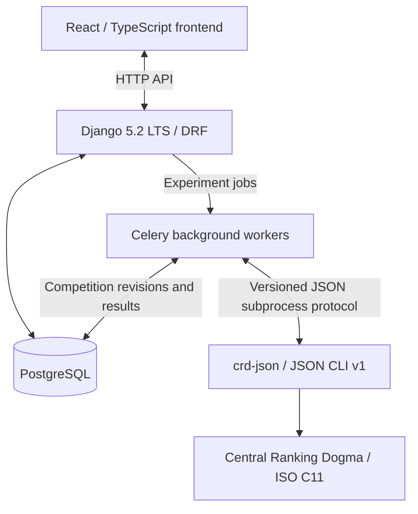

<div align="center">
  <h1>Fantacalcio Dummy System</h1>
  <p><strong>Counterfactual analysis and reproducible simulation of Fantacalcio competitions.</strong></p>
  <p>
    A research-oriented web application designed to investigate how alternative fixture
    calendars affect league standings while keeping historical team performances fixed.
    Powered by the <a href="https://github.com/AlessVolpe/CentralRankingDogma">Central Ranking Dogma</a>
    native simulation engine.
  </p>
  <p>
    <a href="https://github.com/AlessVolpe/FantacalcioDummySystem/actions/workflows/ci.yml"></a>
    <a href="https://github.com/AlessVolpe/FantacalcioDummySystem/actions/workflows/commit-messages.yml"></a>
    <a href="https://github.com/AlessVolpe/FantacalcioDummySystem/actions/workflows/security.yml"></a>
    
    <a href="pyproject.toml"></a>
    <a href="pyproject.toml"></a>
    <a href="https://github.com/AlessVolpe/FantacalcioDummySystem"></a>
    <a href="https://github.com/AlessVolpe/CentralRankingDogma/releases"></a>
    <a href="LICENSE"></a>
    <a href="https://github.com/AlessVolpe/FantacalcioDummySystem/commits/main/"></a>
  </p>
  <p>
    <a href="#the-vision">Overview</a> ·
    <a href="#research-objectives">Research</a> ·
    <a href="#system-architecture">Architecture</a> ·
    <a href="#technology-stack">Technologies</a> ·
    <a href="#development-status">Development</a> ·
    <a href="docs/index.md">Documentation</a> ·
    <a href="#reproducibility-and-limitations">Reproducibility</a> ·
    <a href="#history-and-trivia">History</a> ·
    <a href="#contributing">Contributing</a> ·
    <a href="#licensing">License</a>
  </p>
</div>

---

**Current development status:** the Django backend is initialized; database infrastructure and public features remain in development. The native engine is developed independently in [Central Ranking Dogma](https://github.com/AlessVolpe/CentralRankingDogma). The original Java implementation is preserved in [FantacalcioDummySystem-Deprecated](https://github.com/AlessVolpe/FantacalcioDummySystem-Deprecated). The architecture and application capabilities described below represent the intended direction of the rewrite, not an already operational web service.

## The vision

Fantacalcio is an Italian fantasy football game in which teams receive fantasy scores derived from the performances of footballers. In head-to-head competitions, league points depend not only on a team's own score but also on the score of the opponent it happens to face on a particular matchday.

Fantacalcio Dummy System originates from a simple question: **how differently could a championship have ended if the same teams had played the same matchdays against different opponents?**

The project is intended to provide a platform for reconstructing historical competitions, generating valid alternative fixture calendars and comparing the resulting standings with the original championship. It combines league-data management with computational experiments and statistical visualization, making the effects of fixture assignment accessible to both researchers and Fantacalcio players.

## Research objectives

The original fixture calendar provides the historical reference. Alternative calendars are evaluated against the same recorded matchday fantasy scores and competition rules. Holding those inputs fixed isolates the effect of fixture assignment within the specified simulation model.

The intended research workflow is to:

1. Register or import a competition, its teams, original fixture calendar, matchday scores and scoring rules.
2. Validate and preserve a revision of the competition data.
3. Reconstruct the original standings using the native engine.
4. Generate constrained alternative calendars and resolve the resulting championships.
5. Aggregate the outcomes of seeded Monte Carlo experiments and compare them with the historical baseline.
6. Explore, reproduce and, where appropriate, publish the resulting experiments.

The proposed outputs include team-by-rank frequencies, average finishing positions, changes relative to the original standings, championship-winning frequencies and a bounded selection of individual alternative calendars with their calculated standings. The application is not intended to predict future football results or to reconstruct individual footballer bonus and malus events.

For the mathematical formulation, scheduling constraints and computational methodology, consult the [Central Ranking Dogma scientific documentation](https://github.com/AlessVolpe/CentralRankingDogma/blob/master/docs/index.md) and its [Monte Carlo reference](https://github.com/AlessVolpe/CentralRankingDogma/blob/master/docs/reference/monte-carlo.md).

## System architecture

The application and native engine have distinct responsibilities. The web application is intended to own users, competition data, experiment orchestration, persistent results and visualization. The C engine provides the deterministic and stochastic computations without depending on a database or web framework.



The diagram describes the **planned application architecture**. The native `crd-json` adapter is already implemented upstream; Django initialization is present, while the REST API, React and background-processing layers remain planned.

| Component | Responsibility | Repository |
| --- | --- | --- |
| Fantacalcio Dummy System | Python web application, persistence, experiment orchestration and visualization | [Current repository](https://github.com/AlessVolpe/FantacalcioDummySystem) |
| Central Ranking Dogma | Native calendar generation, match and season resolution, Monte Carlo simulation and ranking research | [Native engine](https://github.com/AlessVolpe/CentralRankingDogma) |
| Fantacalcio Dummy System (deprecated) | Historical Java application and domain reference | [Legacy repository](https://github.com/AlessVolpe/FantacalcioDummySystem-Deprecated) |

The integration boundary is the engine's [JSON CLI v1 contract](https://github.com/AlessVolpe/CentralRankingDogma/blob/master/docs/integration/json-cli-v1.md), exposed by the independent `crd-json` executable. The application should record the exact engine version used by each experiment; the upstream release badge above is informational and does not indicate a pinned application dependency.

Explore the [application architecture](docs/architecture/system.md), [logical module and data model](docs/architecture/modules.md), [research data flow](docs/architecture/data-flow.md) and [architecture decision records](docs/adr/README.md).

## Technology stack

| Layer | Technology | Status |
| --- | --- | --- |
| Python runtime | [Python](https://www.python.org/) | Configured |
| Project and dependency management | [uv](https://docs.astral.sh/uv/) | Configured |
| Web backend | [Django 5.2 LTS](https://www.djangoproject.com/) | Initialized |
| REST API | [Django REST Framework](https://www.django-rest-framework.org/), OpenAPI | Selected; implementation pending |
| Persistence | [PostgreSQL](https://www.postgresql.org/) | Settings and driver configured; provisioning pending |
| Browser authentication | Django sessions, CSRF protection | Selected; implementation pending |
| Web frontend | [React](https://react.dev/) and [TypeScript](https://www.typescriptlang.org/) | Planned |
| Background processing | [Celery](https://docs.celeryq.dev/) | Planned |
| Native simulation engine | [Central Ranking Dogma](https://github.com/AlessVolpe/CentralRankingDogma), ISO C11 | Available upstream; integration planned |
| Deployment | [Docker Compose](https://docs.docker.com/compose/) | Planned |

## Development status

The repository foundations milestone is complete at version 0.1.1. The current implementation milestone is 0.2.0 (Backend foundations). The Django project is initialized, but this baseline is not a functional research web service.

- [x] Establish the separate Python repository and `uv` project scaffold.
- [x] Preserve the previous Java implementation in a separate repository.
- [x] Establish repository governance and contribution policies.
- [x] Configure local development tooling and automated tests.
- [x] Configure continuous integration and dependency security checks.
- [x] Enable required repository rules after successful workflow runs.
- [x] Document the target architecture, logical module boundaries and decision records.
- [x] Select backend technologies, identity and REST API conventions.
- [x] Initialize Django and the custom user model with its initial migration.
- [ ] Provision PostgreSQL and verify migrations against a real database.
- [ ] Finalize implementation-level data models and API contracts.
- [ ] Implement competition management, authentication and historical data import.
- [ ] Integrate `crd-json` and background experiment execution.
- [ ] Implement statistical visualization, experiment inspection and publication.
- [ ] Establish automated verification, deployment and comprehensive documentation.

See the [documentation index](docs/index.md), [backend foundations](docs/architecture/backend.md), [development roadmap](docs/roadmap.md) and [changelog](CHANGELOG.md) for milestone exit criteria, outstanding decisions and the release history.

### Quick start

The installable Python package includes the initialized Django project. With `uv` installed:

```sh
git clone https://github.com/AlessVolpe/FantacalcioDummySystem.git
cd FantacalcioDummySystem
uv sync --locked
uv run --locked fantacalciodummysystem
uv run --locked python manage.py check
```

The legacy entry point still prints `Hello from fantacalciodummysystem!`. The Django system check does not provision or migrate a database. See [Django initialization](docs/architecture/backend.md#django-initialization) for the settings, identity policy and verification commands.

For formatting, linting, static typing, tests, coverage and local Git hooks, see the [local quality checks](CONTRIBUTING.md#local-quality-checks) and
[continuous integration](CONTRIBUTING.md#continuous-integration).

## Reproducibility and limitations

Each experiment is intended to preserve its competition revision, native engine identity, random seed, simulation count, generation settings and aggregate results. Retained individual calendars complement the aggregate statistics but do not replace them. Published results should preserve the applicable anonymization and data-redistribution constraints.

Reproducibility is distinct from statistical representativeness. A seeded sampler can reproduce a sequence of generated calendars without sampling uniformly from the space of all valid calendars. Consequently, observed championship-winning and finishing-position frequencies describe the configured sampling procedure and must not be presented as universal probabilities of sporting success or a complete measure of luck.

For the native engine's existing guarantees and limitations, see its [research methodology](https://github.com/AlessVolpe/CentralRankingDogma/blob/master/docs/research/methodology.md).

## History and trivia

The original Fantacalcio Dummy System repository dates to January 2024 and was developed in Java 21 using Maven and SQLite. Its initial ambition was to provide a way to play or track Fantacalcio leagues, alongside statistical analysis of the influence of match sequencing. That implementation is now deprecated and preserved as a historical and domain reference rather than the codebase for the rewrite.

The project name is a reference to the Dummy System and Dummy Plug from *Neon Genesis Evangelion*, an artificial substitute for an Evangelion's human pilot. The name is particularly appropriate for a system that repeatedly reconstructs hypothetical competitions without requiring their participants to replay them.

The companion project, **Central Ranking Dogma**, continues the same naming convention: its name combines the concept of a ranking system with Central Dogma from *Neon Genesis Evangelion*. Together, the two projects separate the application-facing research platform from its native computational core.

<details>
<summary>The original project tagline</summary>

*The game that took Italy by the heel, revolutionized.*

Preserved from the [original Java README](https://github.com/AlessVolpe/FantacalcioDummySystem-Deprecated/blob/main/README.md).

</details>

## Contributing

See [CONTRIBUTING.md](CONTRIBUTING.md) for the development workflow, mandatory scoped commit messages and reproducibility requirements. Participation is governed by the [Code of Conduct](CODE_OF_CONDUCT.md). Report security vulnerabilities privately as described in [SECURITY.md](SECURITY.md).

## Licensing

Fantacalcio Dummy System is licensed under the [GNU Affero General Public License version 3 only (AGPL-3.0-only)](LICENSE), unless explicitly stated otherwise. The license includes obligations concerning access to the corresponding source of modified versions used over a network.

The [deprecated Java implementation](https://github.com/AlessVolpe/FantacalcioDummySystem-Deprecated/blob/main/LICENSE) and [Central Ranking Dogma](https://github.com/AlessVolpe/CentralRankingDogma/blob/master/LICENSE) retain their own GNU GPL version 3 licensing. This repository does not relicense either project. The native engine remains an independently maintained dependency. The [Code of Conduct](CODE_OF_CONDUCT.md) adopts an independently licensed community standard.
