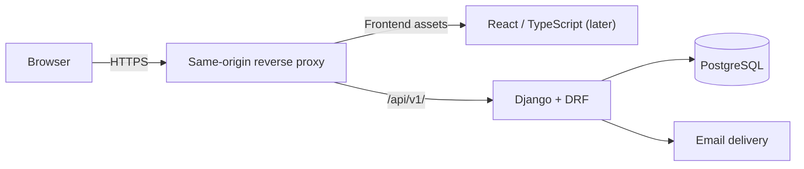

# Backend foundations

**Status:** selected architecture for 0.2.0; not yet implemented.

See [ADR 0006](../adr/0006-backend-stack.md),
[ADR 0007](../adr/0007-identity-and-authentication.md) and
[ADR 0008](../adr/0008-rest-api.md) for decisions and their rationale.

## Target package layout

```text
src/fantacalciodummysystem/
    __init__.py
    config/
        settings/
            base.py
            development.py
            testing.py
            production.py
        urls.py
        asgi.py
        wsgi.py
    accounts/
        models.py
        managers.py
        admin.py
        migrations/
    api/
        v1/
        exceptions.py
        urls.py
manage.py
compose.yaml
.env.example
tests/
    accounts/
    api/
    integration/
    tooling/
```

The layout is a target, not a mandate to create empty folders. Preserve the
existing package and CLI until a documented replacement is implemented.
Django settings select environment-specific configuration; production must
fail closed for missing mandatory secrets, allowed hosts and database settings.
Do not load real credentials from checked-in examples. Development and testing
can use explicitly isolated local configuration. Store timestamps in UTC and
use Django's timezone-aware APIs.

## Deployment boundary



For local development, PostgreSQL runs in Compose and Django runs on the host
through uv. Bind the development database to loopback where a host port is
needed. Production uses server-only database access. The later frontend
should use a development proxy to preserve same-origin browser semantics.
The reverse proxy must forward only trusted HTTPS/host metadata; production
cookie and CSRF configuration must match the actual deployment.

## Verification approach

Keep pure Python tests separate from tests that need Django or PostgreSQL.
Run fresh migrations and migration-drift checks against a real PostgreSQL
instance; test uniqueness, transactions and account lifecycle behavior there.
CI must continue to exercise Python on Linux and Windows. Provision PostgreSQL
on both runner platforms by a supported mechanism (GitHub service containers
are not the Windows solution); do not silently substitute SQLite. Update the
reusable release verification path together with CI when database tests are
introduced. Document local setup and teardown commands before introducing
required database checks. Use Django system checks, strict typing and OpenAPI
schema validation alongside the existing quality/security workflows.

Celery, Redis, native execution, competition models and React remain out of
scope until their planned implementation milestones.
