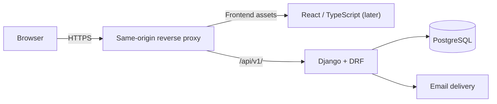

# Backend foundations

**Status:** Django initialization in 0.2.0. PostgreSQL provisioning, public
authentication and REST endpoints remain pending.

See [ADR 0006](../adr/0006-backend-stack.md),
[ADR 0007](../adr/0007-identity-and-authentication.md) and
[ADR 0008](../adr/0008-rest-api.md) for decisions and their rationale.

## Target package layout

```text
src/fantacalciodummysystem/
    __init__.py
    config/
        settings/
            environment.py
            base.py
            development.py
            testing.py
            production.py
        urls.py
        asgi.py
        wsgi.py
    accounts/
        models.py
        managers.py
        backends.py
        admin.py
        migrations/
    api/
        v1/
        exceptions.py
        urls.py
manage.py
compose.yaml
.env.example
tests/
    accounts/
    api/
    integration/
    tooling/
```

The layout is a target, not a mandate to create empty folders. Preserve the
existing package and CLI until a documented replacement is implemented.
Django settings select environment-specific configuration; production must
fail closed for missing mandatory secrets, allowed hosts and database settings.
Do not load real credentials from checked-in examples. Development and testing
can use explicitly isolated local configuration. Store timestamps in UTC and
use Django's timezone-aware APIs.

## Django initialization

The existing `src` package contains the project configuration and `accounts`
application. The original scaffold command remains available. `manage.py`
defaults to development settings; ASGI and WSGI entry points default to
production settings unless `DJANGO_SETTINGS_MODULE` is explicitly set.

- `base`: shared application, session, middleware, UTC and password settings.
- `development`: loopback hosts, isolated database prefix and console email.
- `testing`: separate database prefix, memory email backend, no debug mode.
- `production`: requires `FDS_SECRET_KEY`, `FDS_ALLOWED_HOSTS` and all database
  variables; secure cookies and HTTPS redirect. Configure trusted proxy headers
  and real email delivery during deployment, not through unsafe defaults.

PostgreSQL is configured through `FDS_DEV_DB_`, `FDS_TEST_DB_` or `FDS_DB_`
with suffixes `NAME`, `USER`, `PASSWORD`, `HOST` and `PORT`. Development and
testing use distinct names (`fds_dev`, `fds_test`) and loopback-only hosts by
default, with user `fds`, password `fds-local-only` and port `5432`. These are
local placeholders, not production credentials. Production has no fallback.
The database is not provisioned by these settings; Compose and CI provisioning
land in the next PR. Do not point either local profile at production data.

`AUTH_USER_MODEL = "accounts.User"` is set before the initial migration. The
model uses a UUID primary key, unique canonical email, display name, verification
timestamp, standard Django password hashing and permissions. Administrative
activation is independent of verification. The verified-email backend rejects
inactive and unverified users; the trusted `createsuperuser` command marks its
administrator verified. No public registration, login, recovery, admin or REST
routes are enabled yet. Manager creation is trusted internal code, not a
registration serializer; password validation and email delivery belong to PR 4.

The initial identity policy trims and lowercases ASCII addresses (maximum 254
characters); internationalized domains can use their ASCII A-label form.
Unicode local parts and whitespace inside addresses are not supported by this
baseline. The PostgreSQL `C` collation, uniqueness and a canonical-email check
constraint make concurrent duplicate rejection independent of locale. Do not
rewrite provider-specific plus tags or dots. Review this scope before accepting
real registrations. The database constraint enforces canonical storage, not
complete email syntax validation.

### Local verification

```sh
uv lock
uv sync --locked
uv run --locked python manage.py check --settings=fantacalciodummysystem.config.settings.testing
uv run --locked ruff format --check .
uv run --locked ruff check .
uv run --locked mypy
uv run --locked pytest --cov --cov-report=term-missing
```

Only regenerate the lock when dependencies change; use `uv lock --check` on
subsequent verification. The tests in this PR do not connect to a database.
The migration is version-controlled but must be verified against PostgreSQL
before applying it to real data. In the persistence PR, run
`manage.py makemigrations --check --dry-run`, `manage.py migrate` and the real
PostgreSQL tests using the documented local database. Do not initialize Django's
built-in default user table first. Existing CI and release jobs remain
unchanged until database provisioning is available on both platforms.

## Deployment boundary



For local development, PostgreSQL runs in Compose and Django runs on the host
through uv. Bind the development database to loopback where a host port is
needed. Production uses server-only database access. The later frontend
should use a development proxy to preserve same-origin browser semantics.
The reverse proxy must forward only trusted HTTPS/host metadata; production
cookie and CSRF configuration must match the actual deployment.

## Verification approach

Keep pure Python tests separate from tests that need Django or PostgreSQL.
Run fresh migrations and migration-drift checks against a real PostgreSQL
instance; test uniqueness, transactions and account lifecycle behavior there.
CI must continue to exercise Python on Linux and Windows. Provision PostgreSQL
on both runner platforms by a supported mechanism (GitHub service containers
are not the Windows solution); do not silently substitute SQLite. Update the
reusable release verification path together with CI when database tests are
introduced. Document local setup and teardown commands before introducing
required database checks. Use Django system checks, strict typing and OpenAPI
schema validation alongside the existing quality/security workflows.

Celery, Redis, native execution, competition models and React remain out of
scope until their planned implementation milestones.
