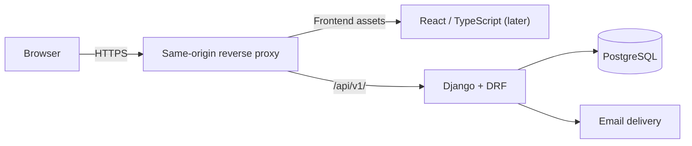

# Backend foundations

**Status:** Django initialization, secret isolation and PostgreSQL persistence
verified in 0.2.0. Authentication is verified; REST API foundations are in
implementation. See [authentication](authentication.md) and [REST API](rest-api.md).

See [ADR 0006](../adr/0006-backend-stack.md),
[ADR 0007](../adr/0007-identity-and-authentication.md),
[ADR 0008](../adr/0008-rest-api.md) and
[ADR 0009](../adr/0009-secrets-and-database-access.md) for decisions and their rationale.

## Target package layout

```text
src/fantacalciodummysystem/
    __init__.py
    config/
        settings/
            environment.py
            base.py
            development.py
            testing.py
            static.py
            production.py
        urls.py
        asgi.py
        wsgi.py
    accounts/
        models.py
        managers.py
        backends.py
        admin.py
        migrations/
    api/
        v1/
        exceptions.py
        urls.py
manage.py
compose.yaml
examples/
    .env.development.example
    .env.testing.example
    .env.postgres.example
pre-commit/
    .pre-commit-config.yaml
tests/
    accounts/
    api/
    integration/
    tooling/
```

The layout is a target, not a mandate to create empty folders. Preserve the
existing package and CLI until a documented replacement is implemented.
Django settings select environment-specific configuration; production must
fail closed for missing mandatory secrets, allowed hosts and database settings.
Do not load real credentials from checked-in examples. Development and testing
can use explicitly isolated local configuration. Store timestamps in UTC and
use Django's timezone-aware APIs.

## Django initialization

The existing `src` package contains the project configuration and `accounts`
application. The original scaffold command remains available. `manage.py`
defaults to development settings; ASGI and WSGI entry points default to
production settings unless `DJANGO_SETTINGS_MODULE` is explicitly set.

- `base`: shared application, session, middleware, UTC and password settings.
- `development`: private signing key, mandatory isolated database settings,
  loopback database host and console email.
- `testing`: mandatory separate database settings, random process-local
  signing key, memory email backend, no debug mode.
- `static`: database-free unit tests and mypy; dummy database backend and random
  process-local signing key. Not a serving or persistence profile.
- `production`: requires `FDS_SECRET_KEY`, `FDS_ALLOWED_HOSTS` and all database
  variables; secure cookies and HTTPS redirect. Configure trusted proxy headers
  and real email delivery during deployment, not through unsafe defaults.

PostgreSQL is configured through `FDS_DEV_DB_`, `FDS_TEST_DB_` or `FDS_DB_`
with suffixes `NAME`, `USER`, `PASSWORD`, `HOST` and `PORT`. All five values
are mandatory in each database-backed profile; no authentication defaults are
available. Development additionally requires `FDS_DEV_SECRET_KEY`. Development
and testing allow loopback database hosts only. See the
[local PostgreSQL setup](../local-postgresql.md) for private environment files,
native and Compose setup, role separation and verification. Integration tests
use the marked dedicated database; CI provisions disposable credentials. Never
use production data or credentials for local or CI tests.

`AUTH_USER_MODEL = "accounts.User"` is set before the initial migration. The
model uses a UUID primary key, unique canonical email, display name, verification
timestamp, standard Django password hashing and permissions. Administrative
activation is independent of verification. The verified-email backend rejects
inactive and unverified users; the trusted `createsuperuser` command marks its
administrator verified. PR 4 introduces the email-first authentication lifecycle,
restricted Django admin and versioned JSON endpoints; manager creation remains
trusted internal code. PR 5 adds DRF resources, RFC 9457 errors, OpenAPI 3.1,
health probes and own display-name editing without rewriting authentication.

The initial identity policy trims and lowercases ASCII addresses (maximum 254
characters); internationalized domains can use their ASCII A-label form.
Unicode local parts and whitespace inside addresses are not supported by this
baseline. The PostgreSQL `C` collation, uniqueness and a canonical-email check
constraint make concurrent duplicate rejection independent of locale. Do not
rewrite provider-specific plus tags or dots. Review this scope before accepting
real registrations. The database constraint enforces canonical storage, not
complete email syntax validation.

### Local verification

```sh
uv lock --check
uv sync --locked
uv run --locked python manage.py check --settings=fantacalciodummysystem.config.settings.static
uv run --locked ruff format --check .
uv run --locked ruff check .
uv run --locked mypy
uv run --locked pytest --cov --cov-report=term-missing
```

Only regenerate the lock when dependencies change; use `uv lock --check` on
subsequent verification. Default pytest remains database-free. For integration
verification, follow the [dedicated database instructions](../local-postgresql.md#5-run-integration-tests).
The fixture validates the marked restricted database before checking migration
drift and applying migrations. CI and reusable release quality jobs run this
suite on Linux and Windows. The security workflow also scans tracked files
for secrets.

## Deployment boundary



For local development, PostgreSQL runs natively or in Compose and Django runs
on the host through uv. Bind the development database to loopback where a host port is
needed. Production uses server-only database access. The later frontend
should use a development proxy to preserve same-origin browser semantics.
The reverse proxy must forward only trusted HTTPS/host metadata; production
cookie and CSRF configuration must match the actual deployment.

## Verification approach

Keep pure Python tests separate from tests that need Django or PostgreSQL.
Run fresh migrations and migration-drift checks against a real PostgreSQL
instance; test uniqueness, transactions and account lifecycle behavior there.
CI exercises Python on Linux and Windows with PostgreSQL 19, using a Linux
container and native Windows binaries with a checked SHA-256. No SQLite
substitution is supported. The existing reusable CI interface includes database
verification in release quality jobs. Use Django system checks, strict typing
and (in the API phase) OpenAPI schema validation alongside quality/security
workflows.

Celery, Redis, native execution, competition models and React remain out of
scope until their planned implementation milestones.
