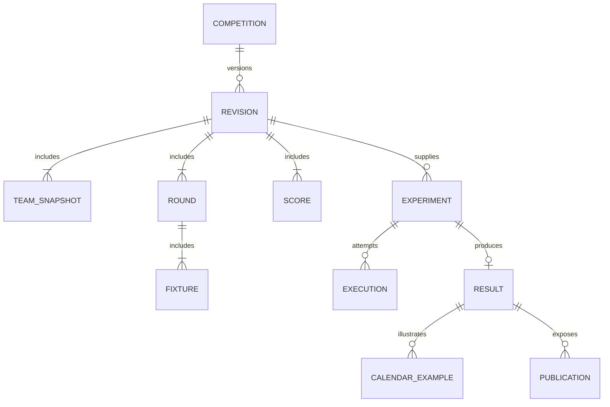

# Module boundaries and logical data model

**Status:** proposed implementation structure. Names and relationships are
logical, not Django model definitions, table names or frozen HTTP contracts.

## Application modules

| Module | Owns | Does not own |
| --- | --- | --- |
| Accounts | Identities, authentication and access policy | Native computation |
| Competitions | Competition ownership, team identities, original fixtures, scores, rules and revisions | Simulation algorithms |
| Integration | CRD request/response types, serialization, transport, error mapping | Persistence and HTTP views |
| Experiments | Configuration, lifecycle, results, provenance and retained examples | HTTP/UI rendering |
| Workers | Job dispatch, bounded execution and recovery | Authoritative experiment state outside the database |
| Publication | Explicit public projections and export authorization | Private competition mutation |
| API / frontend | User-facing commands, reads and presentation | Direct native execution from browser requests |

Keep domain and application services independently testable; a view or task
should invoke them rather than duplicate business rules. Exact Django app paths,
API routes, authentication mechanism and migration strategy belong to the
implementation milestones. Start with a modular monolith; avoid splitting each
logical module into its own deployed service.

## Logical records

| Record | Required concept |
| --- | --- |
| Competition | Owner/access policy, stable identity, editable source data |
| Revision | Immutable team identities, original directed fixtures, Serie A matchday mapping, scores, scoring rules and provenance |
| Experiment | Reference to one revision, scope, effective configuration and seed; separate from execution attempts |
| Execution | Attempt identity, timestamps, worker status, engine identity and bounded diagnostics |
| Result | Historical baseline, accepted/requested counts, completion reason and aggregate statistics |
| Calendar example | Stored display fixtures and standings, generation or selection provenance and replay recipe when available |
| Publication | Explicit authorization, selected result, public projection and consistent anonymization |

A revision preserves the exact historical inputs, not references to mutable rows
that can change silently. The original competition may evolve without changing
prior experiment inputs. Deletion, retention, sharing roles and anonymization
implementation need a dedicated lifecycle design before real data is stored.

## Native invariants at the application boundary

- Preserve stable team UUIDs; never use names or array positions as identity.
- The CLI requires 2–20 teams, even, and 1–80 imported rounds. The native
  contract, not the database schema alone, determines simulation readiness.
- Store or losslessly convert fantasy scores in integer tenths using Decimal at
  the input boundary. A pending score has placeholder zero; a final zero is valid.
- Keep fixtures directed and matchday scores attached to the original mapped
  Serie A matchday. Never shuffle scores with opponents.
- Keep complete rules or explicitly use native defaults. Record the effective
  configuration; do not silently replace missing fields with guesses.

Refer to [CRD JSON CLI v1](https://github.com/AlessVolpe/CentralRankingDogma/blob/master/docs/integration/json-cli-v1.md)
for authoritative bounds, field names and semantics. See also
[ADR 0003](../adr/0003-persistence-strategy.md).
