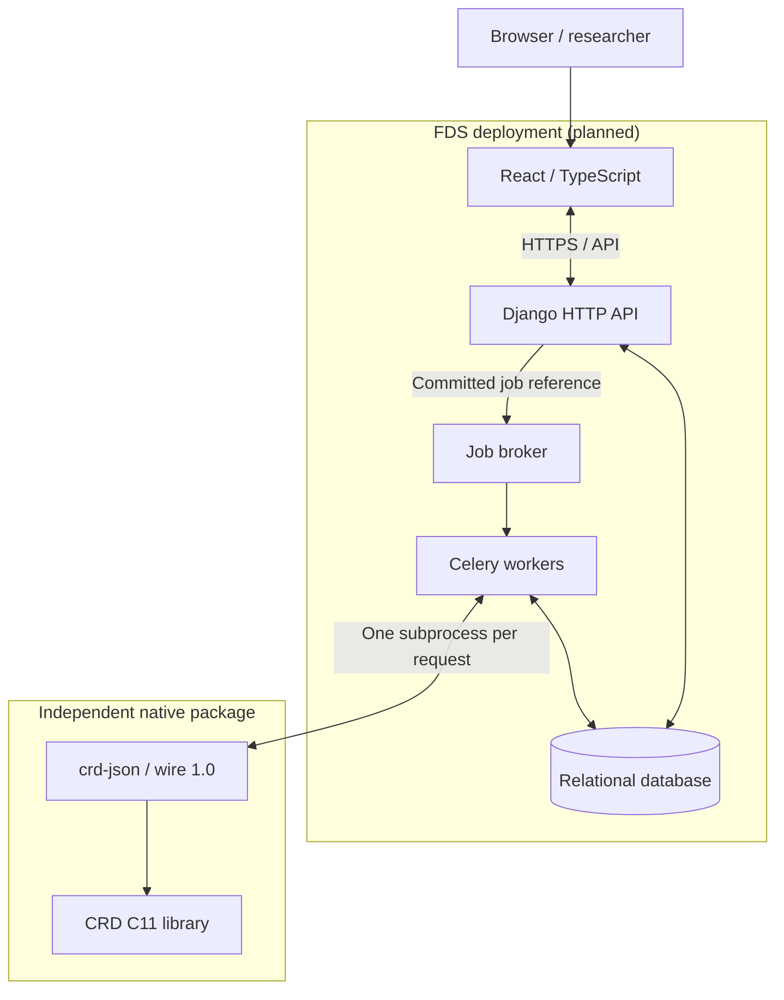

# System architecture

**Status:** target architecture, not implemented in FDS. See the [decision
register](../adr/README.md) for the status of individual choices.

## System boundaries

FDS is the application-facing research platform. CRD is an independently
versioned ISO C11 engine. The deprecated Java project is a historical domain
reference, not a runtime dependency or a migration specification.

Arrows indicate communication, not permission to bypass the application service
layer. The database and broker are not exposed to browsers or native processes.
A worker invokes an installed executable in its own runtime environment; no
standalone CRD service or direct Python binding is required.

| Boundary | Responsibility |
| --- | --- |
| Frontend | Competition editing, experiment configuration and status, basic/advanced statistical views, publication and inspection |
| HTTP API | Authentication, authorization, validation, commands and read models |
| Application/domain services | Competition revision lifecycle, experiment state transitions, publication policy, orchestration |
| Database | Authoritative persistent application state and result records |
| Broker/workers | Bounded asynchronous execution, cancellation and operational retries |
| Native adapter | Versioned JSON transport, response validation, process lifecycle and error translation |
| CRD | Native domain validation, constrained calendar generation, deterministic resolution and Monte Carlo aggregation |

## Deployment and trust

The intended deployment is a Linux VPS using Docker Compose; Windows is a local
development and verification target. The web server and worker can be separate
processes built from one application codebase. Build the CRD executable into the
worker environment and identify the installed artifact; do not fetch an arbitrary
latest executable at runtime. Database and broker credentials stay server-side.

Enforce authorization for reads, writes, job cancellation and exports, including
objects referenced by identifier. Public experiment data is an explicit projection,
not unrestricted access to private competition records. Worker limits and trusted
paths are enforced independently of the native limits. TLS, secret management,
backup and restore, monitoring, and operational quotas are deployment acceptance
criteria, not capabilities of the current scaffold.

See [module boundaries](modules.md), [data flow](data-flow.md) and
[ADR 0001](../adr/0001-system-architecture.md).
